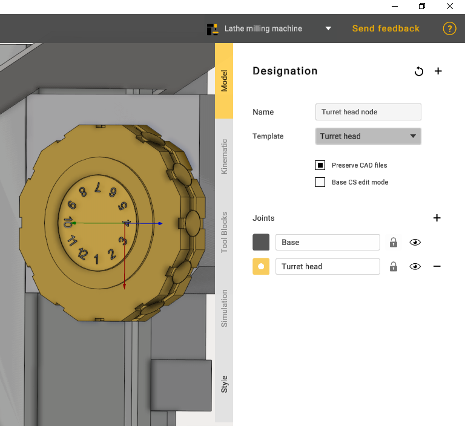
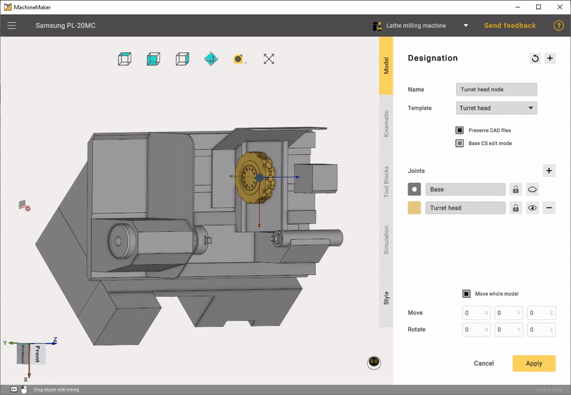

---
title: "터렛 헤드 노드"
---

# 터렛 헤드 노드

다음으로 터렛 헤드 노드를 추가해야 합니다.

Base CS(기준 좌표계)를 메커니즘의 뒷면에 배치하는 것이 중요합니다.

다음으로 블록의 연결 포인트를 배치해야 합니다. 이때 작업을 빠르게 수행하도록 도와주는 Interactive mode(인터랙티브 모드)를 사용할 수 있습니다. 포인트 1개를 끌면 나머지 포인트도 자동으로 설정됩니다.

다음 단계는 연결 포인트에 공구 블록을 배치하는 것입니다. 공구는 2가지 방법으로 추가할 수 있습니다.\
1) 마우스 오른쪽 버튼을 사용합니다.\
2) 드롭다운 메뉴에서 원하는 공구를 선택합니다.

Simulation(시뮬레이션) 탭에서 터렛 헤드가 올바르게 움직이는지 확인한 다음 Apply(적용)를 클릭합니다.

이것으로 선삭-밀링 복합 기계 구성이 완료되었습니다.
