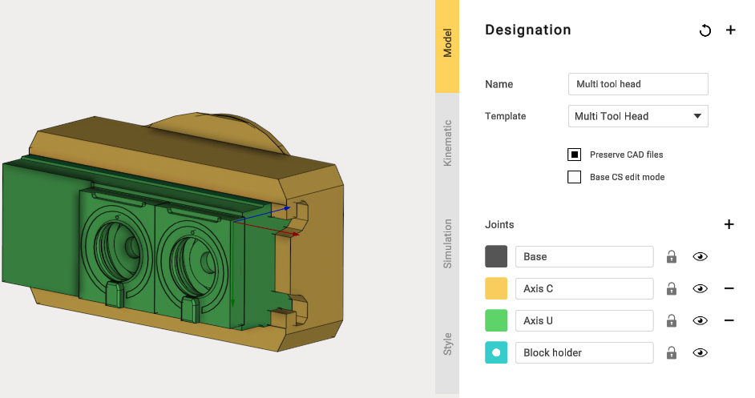
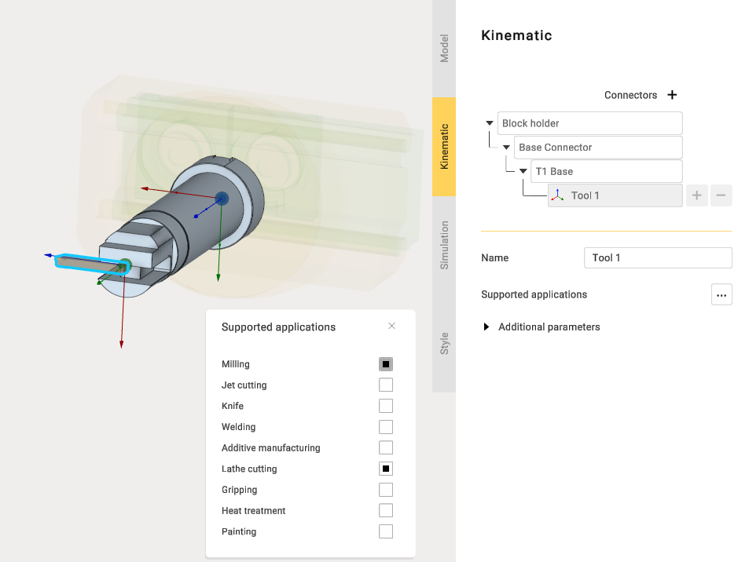
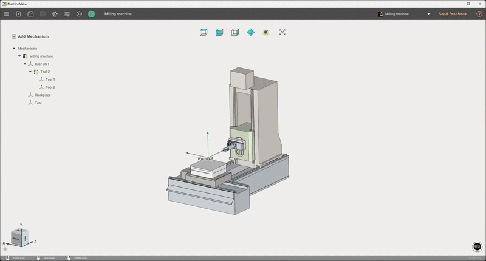

---
title: "멀티 공구 헤드"
---

# 멀티 공구 헤드

Multi Tool Head(멀티 공구 헤드)는 원하는 수만큼 공구 블록을 장착할 수 있도록 만들어졌으며, 이 공구 블록은 쉽게 구성하고 조정할 수 있습니다.\
완전히 사용자 정의된 멀티 공구 헤드를 만들 수 있습니다.

멀티 공구 헤드를 추가하려면 밀링 기계가 포함된 프로젝트를 만들어야 합니다.

**Multi Tool Head**의 뒷면에 장착 포인트를 연결하고 움직이는 구성 요소를 지정합니다.

다음으로 밀링 기계에 장착 포인트를 만들고 **Workpiece**(공작물) 설정을 약간 조정합니다.

멀티 공구 헤드를 밀링 기계에 장착한 후 Tool Blocks View(공구 블록 보기) 창을 열고 이 창에서 장착할 새 공구를 추가합니다.

공구를 추가할 때 Supported Applications(지원 응용 프로그램)에 나열된 모든 유형을 선택할 수 있습니다. 이 예에서는 Lathe Cutting(선반 커팅)을 사용합니다.

여러 공구를 추가할 때는 각 공구가 올바르게 배치되었는지 확인합니다. 공구 위치를 변경하려면 해당 공구의 **Base Connector**(기준 커넥터) 위치를 조정합니다.

프로젝트를 내보낸 후 **Multi Tool Head**가 장착된 기계를 테스트할 수 있습니다.

이 멀티 공구 헤드로 기계를 만드는 방법은 [링크](https://www.youtube.com/watch?v=EIswSr_5KuM&ab_channel=ENCYSoftware)에서 확인할 수 있습니다.
